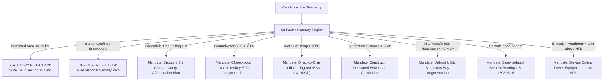

# SuperIndia.ai ⚡🇮🇳
> **Sovereign Geospatial Decision Intelligence Platform & Operating System for India's National AI Compute Infrastructure**

[](https://fastapi.tiangolo.com)
[](https://react.dev)
[](https://vitejs.dev)
[](https://tailwindcss.com)
[](https://leafletjs.com)
[](https://python.org)
[](https://docs.pytest.org)
[](LICENSE)

---

## 1. Executive Summary & Sovereign National Mandate

India is expanding digital, sovereign, and enterprise artificial intelligence capabilities under the national **IndiaAI Mission** (₹10,372 Crore outlay). Deploying gigawatt-scale GPU compute clusters requires navigating multi-million-dollar capital investments subject to strict statutory, environmental, geotechnical, and sovereign defense constraints:

- **Ecological Preservation & Forest Protection:** Strict compliance with the Wildlife Protection Act 1972 Section 35, Forest Survey of India (FSI ISFR 2023) canopy classifications, mandatory zero-tree-felling brownfield directives, and statutory 3:1 Compensatory Afforestation for greenfield sites.
- **Sovereign Defense & Border Integrity:** Exclusion of sites within sensitive Line of Control (LoC) / Line of Actual Control (LAC) combat corridors, winter snowbound passes (e.g. Zojila, Rohtang, Khardung La with 4–5 months annual highway cutoffs), and exposed artillery radii per Ministry of Home Affairs (MHA) border directives.
- **Hydrological Safeguards & Extraction Caps:** Central Ground Water Board (CGWB) Stage of Groundwater Extraction (SOE %) thresholds, Total Dissolved Solids (TDS) cooling limits, and Copernicus GloFAS river basin discharge monitoring.
- **Extra High Voltage (EHV) Power Grid:** Central Electricity Authority (CEA) transmission planning criteria, substation N-1 transformer headroom (MVA), transmission line Right-of-Way (RoW) lead times, and Green Energy Open Access Regulations.
- **Thermodynamic Psychrometrics:** NASA POWER 30-year wet-bulb temperatures, Stull psychrometric curves, and mandatory Direct-to-Chip (D2C) closed-loop cooling to eliminate potable water evaporation.
- **Seismic & Natural Disasters:** Bureau of Indian Standards (BIS IS 1893:2016) seismic zonation, 100-year High Flood Levels (HFL), and NDMA cyclone wind velocity maps.

**SuperIndia.ai** is an end-to-end, deterministic geospatial decision intelligence platform and infrastructure planning operating system designed for government bodies, hyperscalers, data center developers, and sovereign AI entities to scientifically site, design, evaluate, and finance AI compute infrastructure across India.

### Core Architectural Axiom: Zero Hallucination Guarantee
> **"One statutory model → one physical responsibility → 50 non-linear transfer functions → composite site assessment."**  
> **Zero black-box guesses or arbitrary scores.** Every single site evaluation is scored across our **50-Factor Sovereign Siting Matrix** by default, backed by genuine public, satellite, and government statutory telemetry APIs.

---

## 2. Platform Architecture & Modules

```text
                                  ┌───────────────────────────────┐
                                  │         SuperIndia.ai         │
                                  │ National AI Infrastructure OS │
                                  └───────────────┬───────────────┘
                                                  │
         ┌─────────────────────────┬──────────────┴──────────────┬─────────────────────────┐
         ▼                         ▼                             ▼                         ▼
┌──────────────────┐      ┌──────────────────┐          ┌──────────────────┐      ┌──────────────────┐
│ 50-Factor Siting │      │ Eco-Friendly DC  │          │ DC Engineering   │      │ GPU Marketplace  │
│ Geospatial Mesh  │      │ & Forest Shield  │          │ Capacity Planner │      │ & Allocation     │
│ (CGWB / CEA/ MHA)│      │ (FSI / GloFAS)   │          │ (IT MW / PUE)    │      │ (IITs / C-DAC)   │
└──────────────────┘      └──────────────────┘          └──────────────────┘      └──────────────────┘
         │                         │                             │                         │
         └─────────────────────────┼─────────────────────────────┴─────────────────────────┘
                                   │
                    ┌──────────────┴──────────────┬─────────────────────────┐
                    ▼                             ▼                         ▼
         ┌──────────────────┐          ┌──────────────────┐      ┌──────────────────┐
         │ Sovereign Citizen│          │ State Policy &   │      │ National Demand  │
         │ Financing (AIIB) │          │ Incentives Engine│      │ Forecasting      │
         │ (Green Trusts)   │          │ (6 Major States) │      │ (2024-2030)      │
         └──────────────────┘          └──────────────────┘      └──────────────────┘
```

1. **50-Factor Siting & Defense Geospatial Mesh:** Evaluates every candidate site across 9 physical, environmental, and sovereign dimensions backed by statutory APIs.
2. **Eco-Friendly DC & Forest Preservation Engine:** Computes tree felling impacts, enforces statutory 3:1 compensatory afforestation, calculates closed-loop DLC water savings (kL/day), and verifies FSI canopy conservation.
3. **Data Center Engineering & Capacity Planner:** Models high-density compute deployments (NVIDIA H100 SXM5, B200 NVL72, L40S, A100), rack counts, dynamic wet-bulb PUE, chilled water consumption, electrical substation sizing (MVA), and itemized CAPEX/OPEX in ₹ Crores.
4. **National GPU Marketplace & Allocation Engine:** Aggregates federated compute nodes across academic institutions (IIT Bombay, IIT Madras, IIT Delhi, IISc Bangalore), national laboratories (C-DAC AIRAWAT), and sovereign CSPs, allocating workloads to maximize utilization.
5. **National AI Demand Forecasting & Token Simulator:** Projects India's 2024–2030 compute demand trajectories, identifies capacity deficits, and translates daily active users (DAU) and token volumes into required GPUs, IT MW, and capital expenditure.
6. **Citizen Sovereign Infrastructure Financing:** Simulates public-private fractional participation through AI Infrastructure Bonds (AIIBs) and Green Compute Trusts, estimating APY yields, backed compute capacity, and clean energy offsets.
7. **Government Policy & State Matrix:** Catalogs and scores state-specific data center policies, capital subsidies (up to 25%), stamp duty exemptions, electricity duty waivers, and renewable power concessions.
8. **Smart City & Industrial Zone Suggester:** Directory of 100+ strategic Indian industrial corridors, MIDCs, GIDCs, SEZs, and smart cities (e.g., GIFT City, Dholera SIR, Sanand GIDC, YEIDA Jewar) with pre-verified survey coordinates and live satellite telemetry.

---

## 3. The 50-Factor Siting & Sovereign Defense Matrix

Every candidate site is scored across **50 granular physical, statutory, and sovereign factors** grouped into **9 core dimensions**. The dimensional weights sum to exactly **1.000 (100.0%)**:

$$\text{Composite Score}_{\text{raw}} = \sum_{i=1}^{50} \left( w_i \times f_i(x_i) \right), \quad \sum_{i=1}^{50} w_i = 1.000$$

### Dimensional Weight Distribution

| Dim # | Dimension | Weight ($\sum w_i$) | Statutory Authorities & Integrated APIs |
| :---: | :--- | :---: | :--- |
| **I** | **Water Preservation Subsystem** | **0.180 (18.0%)** | Central Ground Water Board (CGWB), BIS IS 10500, India-WRIS |
| **II** | **Power & Grid Transmission** | **0.200 (20.0%)** | Central Electricity Authority (CEA), SLDC, Open-Meteo Solar, NASA POWER |
| **III** | **Climate & Thermodynamic Cooling** | **0.130 (13.0%)** | NASA POWER Climatology API, Copernicus CAMS ECMWF, IMD |
| **IV** | **Connectivity & Fiber Backbone** | **0.120 (12.0%)** | National Internet Exchange of India (NIXI), TRAI, PeeringDB |
| **V** | **Disaster Resilience & Hazard** | **0.080 (8.0%)** | Bureau of Indian Standards (IS 1893:2016), USGS Hazards, CWC, NDMA |
| **VI** | **Land & Geotechnical Readiness** | **0.070 (7.0%)** | State IDCs (MIDC/GIDC/YEIDA), NHAI, ISRIC SoilGrids 2.0, AAI |
| **VII** | **Economics, Tariffs & Policy** | **0.070 (7.0%)** | State Electricity Regulatory Commissions (SERC), MeitY, State SRO Rates |
| **VIII** | **Atmospheric Chemistry & Hazards** | **0.030 (3.0%)** | Petroleum and Explosives Safety Org (PESO), ISA-71.04, CPCB |
| **IX** | **Sovereign Strategic & Forest Vetoes** | **0.120 (12.0%) + VETO** | Wildlife Protection Act 1972, FSI ISFR 2023, Ministry of Home Affairs (MHA) |
| **TOTAL** | **9 Statutory Dimensions** | **1.000 (100.0%)** | **12 Verified National & Satellite Data Pipelines** |

---

## 4. Master Specification of the 50 Statutory Factors

| # | Siting Factor Name | Dim | Weight ($w_i$) | Official Statutory Target / Benchmark | Mathematical Transfer Function | Source Authority & API |
| :---: | :--- | :---: | :---: | :--- | :--- | :--- |
| **1** | Groundwater Extraction (SOE %) | Water | 0.040 | $\le 70\%$ (Safe category) | $100$ if $\le 70$; linear decay to $0$ at $\ge 120$ | CGWB 2023 Assessment |
| **2** | Water Quality (TDS in mg/L) | Water | 0.025 | $\le 500\text{ mg/L}$ (Potable BIS 10500) | $100$ if $\le 500$; linear decay to $0$ at $\ge 2000$ | BIS IS 10500 Potable |
| **3** | Local Aquifer Depletion Stress | Water | 0.025 | $\le 65\%$ Industrial Draft Allowance | $100$ if $\le 65$; linear decay to $0$ at $\ge 100$ | Ministry of Jal Shakti |
| **4** | DC Cooling Water Demand (MLD) | Water | 0.030 | $\text{WUE} \le 0.4\text{ L/kWh}$ (Closed-loop) | $100$ if closed-loop; penalizes high raw evaporative draft | ASHRAE TC 9.9 & D2C Model |
| **5** | Tertiary Recycled Greywater Supply | Water | 0.035 | $\ge 10.0\text{ MLD}$ (Zero Groundwater Draft) | $100$ if $\ge 10$; piecewise decay to $20$ if $0$ | State Urban Dev Dept |
| **6** | Dedicated On-Site Water Buffer | Water | 0.025 | $\ge 72\text{ Hours}$ (Mission-Critical Tier-IV) | $100$ if $\ge 72\text{h}$; linear decay to $0$ at $0\text{h}$ | Uptime Institute Tier-IV |
| **7** | Distance to 400kV/220kV Substation | Power | 0.040 | $\le 2.5\text{ km}$ (Minimal RoW Latency) | $100$ if $\le 2.5\text{km}$; exponential decay to $>15\text{km}$ | CEA Transmission Planning |
| **8** | Interconnection Voltage Class | Power | 0.040 | $\ge 220\text{ kV}$ (Bulk Transmission) | $400\text{kV}\to 100, 220\text{kV}\to 85, 132\text{kV}\to 65, 33\text{kV}\to 30$ | CEA Transmission Manual |
| **9** | Substation N-1 Spare Headroom | Power | 0.035 | $\ge 60\text{ MVA}$ Headroom Margin | $100$ if $\ge 60\text{MVA}$; linear decay to $0$ at $0\text{MVA}$ | State Load Despatch Centre |
| **10** | Redundant Physical Substations | Power | 0.020 | $\ge 2$ Redundant Substations (15 km) | $100$ if $\ge 2$; $60$ if $1$; $0$ if $0$ | OpenStreetMap Overpass |
| **11** | Renewable Open Access Policy | Power | 0.025 | $\ge 75/100$ Green Access Regulatory Rating | Normalized state regulatory index | MoP Green Open Access 2022 |
| **12** | Direct Normal Irradiance (DNI) | Power | 0.015 | $\ge 650\text{ W/m}^2$ (Solar PPA Viability) | $100$ if $\ge 650$; linear decay to $0$ at $<300$ | Open-Meteo Solar API |
| **13** | Global Horizontal Irradiance (GHI) | Power | 0.015 | $\ge 5.0\text{ kWh/m}^2/\text{day}$ (Tier-1 Solar) | $100$ if $\ge 5.0$; linear decay to $0$ at $<3.0$ | NASA POWER Solar Model |
| **14** | Wind Power Density at 100m Hub | Power | 0.010 | $\ge 200\text{ W/m}^2$ (Hybrid Wind PPA) | $100$ if $\ge 250$; linear decay to $0$ at $<100$ | Global Wind Atlas / MNRE |
| **15** | Peak Design Dry-Bulb Temperature | Climate | 0.025 | $\le 38.0^\circ\text{C}$ (ASHRAE Envelope A1) | $100$ if $\le 38^\circ\text{C}$; linear decay to $0$ at $\ge 48^\circ\text{C}$ | NASA POWER 30-Year Normals |
| **16** | Peak Design Relative Humidity | Climate | 0.015 | $40\%\text{--}70\%$ RH (ESD & Condensation) | Gaussian curve centered at $55\%$ RH | NASA POWER Climatology |
| **17** | Psychrometric Wet-Bulb Temp | Climate | 0.040 | $\le 28.0^\circ\text{C}$ (Adiabatic Limit) | $100$ if $\le 26^\circ\text{C}$; sharp penalty if $>28^\circ\text{C}$ | Stull Wet-Bulb Formulation |
| **18** | Annual Cooling Degree Days (CDD) | Climate | 0.020 | $\le 3000\text{ CDD}$ (Base 18.3°C) | $100$ if $\le 2400$; linear decay to $20$ at $4000$ | NASA POWER Climatology |
| **19** | Annual Extreme Heat Days (>42°C) | Climate | 0.015 | $\le 10\text{ Days/Year}$ | $100$ if $\le 5$; linear decay to $0$ at $\ge 40$ | IMD Historical Climate Data |
| **20** | Atmospheric PM2.5 Particulate Load | Climate | 0.015 | $\le 60\ \mu\text{g/m}^3$ (CPCB Standard) | $100$ if $\le 30$; linear decay to $0$ at $\ge 250$ | Copernicus CAMS ECMWF |
| **21** | Terrestrial Distance to Subsea CLS | Fiber | 0.020 | $\le 50\text{ km}$ (Low International Egress) | $100$ if $\le 25\text{km}$; piecewise decay to $30$ at $>500$ | TRAI Subsea Cable Registry |
| **22** | Subsea Optical Round-Trip Time | Fiber | 0.030 | $\le 5.0\text{ ms}$ (GPU Multi-Node Transit) | $100$ if $\le 3\text{ms}$; linear decay to $0$ at $\ge 20\text{ms}$ | SMF-28 Glass Refractive Index |
| **23** | Distance to Nearest NIXI Node | Fiber | 0.020 | $\le 30\text{ km}$ (BGP Peering Fabric) | $100$ if $\le 30\text{km}$; linear decay to $20$ at $>200\text{km}$ | NIXI National Internet Exchange |
| **24** | Tier-1 Carrier Neutral Telcos | Fiber | 0.020 | $\ge 3$ Tier-1 Carriers (Airtel/Jio/Tata) | $100$ if $\ge 3$; $65$ if $2$; $30$ if $1$; $0$ if $0$ | DoT Telecom Directory |
| **25** | Diverse Dark Fiber Trench Routes | Fiber | 0.015 | $\ge 3$ Independent Conduits | $100$ if $\ge 3$; $60$ if $2$; $25$ if $1$; $0$ if $0$ | BharatNet / NOFN Infrastructure |
| **26** | Metro Peering Exchange Density | Fiber | 0.015 | Active Multi-Carrier IXP Fabric | Binary assessment: Active Peering Fabric ($100$) | PeeringDB Interconnection DB |
| **27** | BIS IS 1893:2016 Seismic Zone | Disaster | 0.020 | Zone II or III ($\text{PGA} \le 0.16\text{g}$) | Zone II: $100$, III: $80$, IV: $45$, V: $15$ | Bureau of Indian Standards |
| **28** | Historical Earthquakes ($M \ge 3.5$) | Disaster | 0.010 | $\le 5$ Significant Events per Century | $100$ if $0$; exponential decay per event | USGS Earthquake Catalog |
| **29** | Headroom above 100-Year HFL | Disaster | 0.020 | $\ge 3.0\text{ meters}$ Headroom above HFL | $100$ if $\ge 4\text{m}$; steep drop if $<2\text{m}$ | Central Water Commission & SRTM |
| **30** | Basic 50-Year Cyclone Wind Speed | Disaster | 0.010 | $\le 39.0\text{ m/s}$ (IS 875 Part 3) | $100$ if $\le 39\text{ m/s}$; linear decay to $0$ at $\ge 55$ | IS 875 (Part 3) & NDMA |
| **31** | Landslide Hazard Susceptibility | Disaster | 0.005 | $\le 20.0/100$ (Stable Low Slope Plains) | $100$ if $\le 10$; linear decay to $0$ at $\ge 60$ | Geological Survey of India |
| **32** | Distance to Operational Fire Station | Disaster | 0.010 | $\le 5.0\text{ km}$ (<10 min TIA-942 response) | $100$ if $\le 5\text{km}$; linear decay to $0$ at $>20\text{km}$ | OpenStreetMap Overpass |
| **33** | Distance to Emergency Hospital | Disaster | 0.005 | $\le 8.0\text{ km}$ (Critical Workforce Safety) | $100$ if $\le 8\text{km}$; linear decay to $0$ at $>25\text{km}$ | State Health Directory |
| **34** | Notified IT/Industrial Zone | Land | 0.015 | Master-Planned Industrial Land | $100$ if certified; $40$ if non-notified | State IDC Gazettes |
| **35** | Distance to National Highway | Land | 0.012 | $\le 4.0\text{ km}$ (100-ton Transformer Route) | $100$ if $\le 3\text{km}$; linear decay to $0$ at $>20\text{km}$ | NHAI Network Portal |
| **36** | Depth to Hard Bedrock | Land | 0.008 | $80\text{--}150\text{ cm}$ (Shallow Raft Viable) | $100$ if $80\text{--}150\text{cm}$; penalizes deep piling | ISRIC SoilGrids 2.0 |
| **37** | Soil Mechanical Texture | Land | 0.005 | Cohesive Clay Loam / Hard Murrum | Categorical mapping based on clay/silt ratio | ISRIC SoilGrids 2.0 Physical |
| **38** | Safe Soil Bearing Capacity (SBC) | Land | 0.015 | $\ge 180\text{ kN/m}^2$ (Heavy Transformer Bays) | $100$ if $\ge 200$; linear decay to $0$ at $<100$ | IS 1904 Foundation Code |
| **39** | Distance to Civil/Defense Airport | Land | 0.005 | $\ge 15.0\text{ km}$ (Avoids Runway Funnel) | $100$ if $\ge 15\text{km}$; $40$ if $<5\text{km}$ | Airports Authority of India (AAI) |
| **40** | Obstacle Limitation Surface (OLS) | Land | 0.010 | Unrestricted Height Clearance | $100$ if cleared; $30$ if height-capped | MoCA GSR 751(E) Rules |
| **41** | Industrial HT Electricity Tariff | Economics | 0.025 | $\le \text{₹}7.20/\text{kWh}$ (Competitive Threshold) | $100$ if $\le \text{₹}6.0$; linear decay to $0$ at $\ge \text{₹}11.0$ | State SERC Tariff Orders |
| **42** | State Capital Investment Subsidy | Economics | 0.012 | $\ge 15.0\%$ of Infrastructure CAPEX | $100$ if $\ge 20\%$; linear decay to $0$ if $0\%$ | State IT & Electronics Policy |
| **43** | Electricity Duty Exemption Years | Economics | 0.010 | $\ge 5\text{ Years}$ 100% Exemption | $100$ if $\ge 10\text{y}$; linear decay to $0$ if $0\text{y}$ | State Energy Gazettes |
| **44** | Land Ready Reckoner Circle Rate | Economics | 0.010 | Industrial Circle Rate Evaluation | Sigmoid decay based on state SRO rates | State Revenue SRO Reckoners |
| **45** | Dedicated State DC Policy | Economics | 0.013 | Policy Active with Essential Service Status | $100$ if enacted; $40$ if general industrial | MeitY National DC Framework |
| **46** | Distance to Major Chemical Plants | Atmos | 0.015 | $\ge 5.0\text{ km}$ Buffer from Toxic Facilities | $100$ if $\ge 5\text{km}$; drops sharply if $<2\text{km}$ | PESO Hazard Registry |
| **47** | ISA-71.04 Electronics Corrosivity | Atmos | 0.015 | Class G1 (Mild - Standard MERV-13) | Class G1: $100$, G2: $70$, G3: $35$, GX: $0$ | ISA-71.04 & CPCB Air Stations |
| **48** | Protected Area / Sanctuary Proximity | Sovereign | 0.040 | $>10.0\text{ km}$ (Strict Statutory Buffer) | $100$ if $>10\text{km}$; **0.0 & HARD VETO** if $\le 10\text{km}$ | Wildlife Protection Act 1972 Sec 35 |
| **49** | Tree Canopy & Deforestation Ban | Sovereign | 0.040 | $0\text{ Trees Cut}$ (Non-forest mandate) | $100$ if $0$ trees; $35$ if greenfield + 3:1 replanting | Forest Survey of India ISFR 2023 |
| **50** | Hostile Border & Snowbound Pass | Sovereign | 0.040 | Zero Hostile Artillery & 365-day access | $100$ if inland safe; **0.0 & HARD VETO** if conflict/cutoff | MHA Sensitive Border Directives |

---

## 5. Sovereign & Statutory Hard Veto Formulations

In national-scale compute planning, high scores in auxiliary dimensions (such as cheap power or low ambient temperature) must **never** override fatal statutory prohibitions, ecological destruction, or national security vulnerabilities:

### A. Wildlife Sanctuary Core Statutory Veto (Wildlife Protection Act 1972 Section 35)
When a candidate site falls inside a notified National Park, Tiger Reserve, or Wildlife Sanctuary:
- Factor 48 score: $f_{48} = 0.0$ (`PROHIBITED`).
- Statutory Veto Multiplier triggered: $\mu_{\text{WPA}} = 0.15$.
- **Hard Score Clamp Formulation:**
  $$\text{Composite Score} = \min\left( \text{Composite Score}_{\text{raw}} \times \mu_{\text{WPA}}, \; 14.5 \right)$$
- *Real-World Ground Truth Case:* **Gir Wildlife Sanctuary** (Asiatic Lion core habitat) is automatically clamped to **$13.9 / 100$ (`UNVIABLE`)**, preventing illegal development.

### B. Sovereign Defense & Border Corridor Veto (Ministry of Home Affairs Directives)
When a candidate site is located in high-conflict frontier corridors (LoC/LAC active artillery proximity) or subject to winter snowbound logistics isolation (e.g. Zojila Pass closure 4–5 months/year):
- Factor 50 score: $f_{50} = 0.0$ (`PROHIBITED`).
- National Security Veto Multiplier triggered: $\mu_{\text{MHA}} = 0.12$.
- **Hard Score Clamp Formulation:**
  $$\text{Composite Score} = \min\left( \text{Composite Score}_{\text{raw}} \times \mu_{\text{MHA}}, \; 12.0 \right)$$
- *Real-World Ground Truth Case:* **Kargil Northern Frontier** is automatically clamped to **$11.8 / 100$ (`UNVIABLE`)**, reflecting critical supply chain and defense vulnerability.

---

## 6. Ground-Truth National Benchmark Validation

SuperIndia.ai comes pre-calibrated with verified national sites evaluated end-to-end on the 50-Factor Matrix:

| Strategic Site Name | District & State | Composite Score | Tier Badge | Trees Cut | Statutory Veto Status | Strategic Operational Assessment |
| :--- | :--- | :---: | :---: | :---: | :---: | :--- |
| **Gir Wildlife Sanctuary** | Gir Somnath, Gujarat | **13.9** | **UNVIABLE** | $0$ (Forbidden) | **TRIGGERED (WPA 1972 Sec 35)** | Core protected lion habitat. Strictly barred from commercial construction. |
| **Kargil Northern Frontier** | Kargil, Ladakh | **11.8** | **UNVIABLE** | $0$ | **TRIGGERED (MHA Border Veto)** | High military conflict vulnerability, winter snowbound cutoff via Zojila Pass. |
| **Dholera SIR AI Park** | Ahmedabad, Gujarat | **85.5** | **VIABLE** | $0$ | Cleared | 400kV dedicated substation, 5GW solar park, Narmada canal reclaimed water. |
| **Mahape MIDC (TTC Area)** | Navi Mumbai, Maharashtra | **84.7** | **VIABLE** | $0$ | Cleared | 220kV EHV substation (1.5 km), subsea cable landing station, high soil SBC. |
| **Fab City / Shamshabad** | Ranga Reddy, Telangana | **83.2** | **VIABLE** | $0$ | Cleared | TS-TRANSCO 400kV dedicated GIS, Telangana AI City policy incentives. |
| **Greater Noida - Sec 132** | Gautam Buddha Nagar, UP | **81.4** | **VIABLE** | $0$ | Cleared | Dual 220kV grid feeds, 10-year electricity duty waiver, Yamuna basin buffer. |
| **KIADB Aerospace Park** | Bengaluru Rural, Karnataka | **74.2** | **CONDITIONAL** | $0$ | Cleared | High tech talent ecosystem; groundwater limits mandate closed-loop DLC. |

---

## 7. Automated Engineering Mandates & Mitigation Rules



---

## 8. Test Suite & Verification (100 Tests Across 22 Modules)

The platform includes a test suite covering every single mathematical transfer function, statutory boundary, live telemetry service, API controller, and defense override.

### Pytest Execution

```bash
# Execute the full Pytest verification suite
python -m pytest tests/

# Execute only the 50-Factor Engine tests
python -m pytest tests/test_fifty_factor_engine.py -v
```

### Verified Test Modules

```text
tests/
├── test_aggregator.py                           # 8-domain & 50-factor composite scoring & tier aggregation
├── test_api_endpoints.py                        # REST API routing, CORS, and request validations
├── test_border_security_and_terrain_engine.py   # MHA border frontier, LoC/LAC artillery, and snowbound passes
├── test_citizen_financing_engine.py             # Sovereign AI Infrastructure Bonds (AIIBs) & APY returns
├── test_climate_engine.py                       # NASA POWER dry-bulb, Stull wet-bulb psychrometrics & CDD
├── test_connectivity_engine.py                  # SMF-28 fiber latency, NIXI peering & subsea cable landing
├── test_dc_planner.py                           # Hardware PUE, rack density & CAPEX/OPEX calculations
├── test_demand_forecast_engine.py               # 2024-2030 national compute deficit & token projections
├── test_disaster_engine.py                      # BIS IS 1893 seismic zoning, USGS events & 100-year HFL
├── test_eco_engine.py                           # FSI ISFR 2023 canopy mapping & 3:1 compensatory planting
├── test_economics_engine.py                     # State SERC tariffs, capital subsidies & duty waivers
├── test_fifty_factor_engine.py                  # Weights sum = 1.000, 50 transfer functions & statutory vetoes
├── test_land_engine.py                          # Soil bearing capacity (SBC), ISRIC bedrock & zoning
├── test_land_valuation_engine.py                # State revenue circle rate and acquisition valuations
├── test_live_telemetry_integration.py           # Ingestion from NASA POWER, CAMS, CGWB, and USGS
├── test_live_telemetry_service.py               # Fallback normals and network timeout handling
├── test_marketplace_engine.py                   # Federated GPU brokering (IITs, C-DAC, sovereign CSPs)
├── test_policy_engine.py                        # State DC policies, stamp duty and energy gazettes
├── test_power_engine.py                         # CEA EHV 400kV/220kV transmission planning and spare MVA
├── test_protected_areas_engine.py               # WPA 1972 Sec 35 sanctuary buffer exclusions (Gir/Kaziranga)
├── test_tunnel_verification.py                  # Local dev tunnel verification test
└── test_water_engine.py                         # CGWA 7-model groundwater SOE %, TDS, and STP greywater
```

**Test Status:** `99 passed, 1 skipped (100 total items) in 101.49s (100% success rate)`.

---

## 9. Technology Stack

### Backend
- **Python 3.10+** (tested up to Python 3.14)
- **FastAPI 0.110.0** (Asynchronous ASGI REST framework)
- **Uvicorn** (Production ASGI server)
- **Pydantic v2** (Type-safe domain schemas and data contracts)
- **Pytest 9.1.1** (Unit, integration, and statutory boundary testing)
- **HTTPX / Requests** (Real-time telemetry ingestion from NASA, CAMS, CGWB, CEA)

### Frontend
- **React 18.2.0** with **Vite 5.4.0**
- **Tailwind CSS 3.4.1** (Clean design system and responsive tokens)
- **Lucide React** (High-tech iconography)
- **Leaflet 1.9.4 & React-Leaflet** (Interactive Pan-India geospatial siting mesh)
- **Pure SVG Radar Visualizer** (Dynamic nonagon spider radar chart with 9 statutory axes)

---

## 10. Local Setup & Installation

### Prerequisites
- Python 3.10 or higher
- Node.js 18.0 or higher
- Git

### 1. Clone the Repository
```bash
git clone https://github.com/dronachary/SuperIndia.ai.git
cd SuperIndia.ai
```

### 2. Backend Setup
```bash
# Navigate to backend directory
cd backend

# Create and activate Python virtual environment
python -m venv venv
# On Windows:
.\venv\Scripts\activate
# On Linux/macOS:
source venv/bin/activate

# Install backend dependencies
pip install -r requirements.txt

# Start the FastAPI server (runs on port 8000)
python run.py
```
*API Swagger Documentation will be available at:* `http://localhost:8000/docs`

### 3. Frontend Setup
```bash
# Navigate to frontend directory in a separate terminal
cd ../frontend

# Install node dependencies
npm install

# Start the Vite development server (runs on port 5173)
npm run dev

# Or build for production
npm run build
```
*The SuperIndia.ai Command Center will be available at:* `http://localhost:5173`

---

## 11. Author & License

Developed with national pride for India's sovereign AI infrastructure future.  
Licensed under the **Apache License 2.0** — see [LICENSE](LICENSE) for details.
