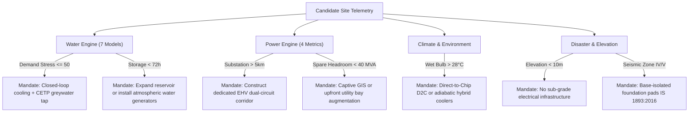

# SuperIndia.ai ⚡🇮🇳
> **Deterministic Geospatial Decision Intelligence Platform & Operating System for India's National AI Compute Infrastructure**

[](https://fastapi.tiangolo.com)
[](https://react.dev)
[](https://vitejs.dev)
[](https://tailwindcss.com)
[](https://leafletjs.com)
[](https://python.org)
[](LICENSE)

---

## 1. Executive Summary & National Imperative

India is undergoing an unprecedented expansion of digital, enterprise, and sovereign artificial intelligence capabilities under the national **IndiaAI Mission** (₹10,372 Crore outlay). However, deploying hyperscale GPU data center clusters requires navigating severe, interconnected physical and regulatory bottlenecks:
- **Hydrological Scarcity & Extraction Limits:** Central Ground Water Authority (CGWA) groundwater extraction caps, municipal water rationing, and high Total Dissolved Solids (TDS) impacting cooling towers.
- **Extra High Voltage (EHV) Grid Headroom:** Central Electricity Authority (CEA) transmission planning criteria, substation N-1 contingency limits, transmission line Right-of-Way (RoW) lead times, and Green Energy Open Access Regulations.
- **Thermodynamic Cooling Efficiency:** Elevated ambient wet-bulb temperatures demanding high Water Usage Effectiveness (WUE) or advanced Direct-to-Chip (D2C) and immersion cooling solutions.
- **Physical Resilience & Policy Variations:** Multi-hazard disaster exposure (BIS IS 1893 seismic zoning, 100-year flood zones, coastal high-tide surges) paired with divergent state-level capital subsidies and power tariff incentives.

**SuperIndia.ai** is an end-to-end, deterministic geospatial decision intelligence platform and infrastructure planning operating system designed for government bodies, hyperscalers, data center operators, and enterprise AI builders to scientifically site, design, allocate, and finance AI compute infrastructure across India.

### Core Architecture Axiom
> **"One model → one responsibility → domain aggregator → composite site assessment."**  
> **Zero black-box hallucinations.** All engineering evaluations, tier classifications, and mitigation mandates are derived mathematically and deterministically from physical telemetry, utility tariffs, and statutory engineering standards.

---

## 2. Core Platform Capabilities & Modules

SuperIndia.ai integrates seven core modules into a cohesive operational system:

```text
                                  ┌───────────────────────────────┐
                                  │         SuperIndia.ai         │
                                  │ National AI Infrastructure OS │
                                  └───────────────┬───────────────┘
                                                  │
         ┌─────────────────────────┬──────────────┴──────────────┬─────────────────────────┐
         ▼                         ▼                             ▼                         ▼
┌──────────────────┐      ┌──────────────────┐          ┌──────────────────┐      ┌──────────────────┐
│ 7-Domain Siting  │      │ Data Center      │          │ GPU Marketplace  │      │ National Demand  │
│ Geospatial Mesh  │      │ Capacity Planner │          │ & Allocation     │      │ Forecasting      │
│ (CGWA / CEA)     │      │ (IT MW / PUE)    │          │ (IITs / C-DAC)   │      │ (2024-2030)      │
└──────────────────┘      └──────────────────┘          └──────────────────┘      └──────────────────┘
         │                         │                             │                         │
         └─────────────────────────┼─────────────────────────────┴─────────────────────────┘
                                   │
                    ┌──────────────┴──────────────┐
                    ▼                             ▼
         ┌──────────────────┐          ┌──────────────────┐
         │ Sovereign Citizen│          │ State Policy &   │
         │ Financing (AIIB) │          │ Incentives Engine│
         │ (Green Trusts)   │          │ (6 Major States) │
         └──────────────────┘          └──────────────────┘
```

1. **7-Domain Geospatial Siting Mesh:** Computes deterministic viability across Water, Power, Climate, Connectivity, Disaster Resilience, Land, and Economics.
2. **Data Center Engineering & Capacity Planner:** Models real-world hardware deployments (NVIDIA H100 SXM5, B200 NVL72, L40S, A100), rack densities, dynamic wet-bulb PUE, cooling water consumption (MLD), electrical substation sizing (MVA), and itemized CAPEX/OPEX in ₹ Crores.
3. **National GPU Marketplace & Allocation Engine:** Aggregates federated compute nodes across academic institutions (IIT Bombay, IIT Madras, IIT Delhi, IISc Bangalore), national laboratories (C-DAC AIRAWAT), and sovereign CSPs, allocating workloads to maximize utilization and minimize cost.
4. **National AI Demand Forecasting & Token Simulation:** Tracks India's 2024–2030 compute demand trajectories, project deficits, and translates daily active users (DAU) and token volumes into required GPUs, IT MW, and capital expenditure.
5. **Citizen Sovereign Infrastructure Financing:** Simulates public-private fractional participation through AI Infrastructure Bonds (AIIBs) and Green Compute Trusts, estimating APY yields, backed compute capacity, and clean energy offsets.
6. **Government Policy & State Matrix:** Catalogs and scores state-specific data center policies, capital subsidies (up to 25%), stamp duty exemptions, electricity duty waivers, and renewable power concessions.
7. **City Suggestion Engine & Greenfield Simulator:** Fast-entry directory of 100+ strategic Indian industrial nodes, SEZs, and smart cities (e.g., GIFT City, Dholera SIR, Sanand GIDC, YEIDA Jewar) with pre-verified survey coordinates and elevations.

---

## 3. Mathematical Formulations & Engineering Engines

### A. 7-Domain Composite Site Score Formulation

The platform synthesizes physical and regulatory attributes into a single composite index:

$$\text{Composite Score} = \sum_{k=1}^{7} \left( \text{Domain Score}_k \times \text{Weight}_k \right)$$

$$\begin{aligned}
\text{Composite Score} = \;&(\text{Water Score} \times 0.20) + (\text{Power Score} \times 0.25) + (\text{Climate Score} \times 0.15) \\
&+\; (\text{Connectivity Score} \times 0.15) + (\text{Disaster Score} \times 0.10) \\
&+\; (\text{Land Score} \times 0.08) + (\text{Economics Score} \times 0.07)
\end{aligned}$$

| Domain | Weight | Standards & Regulatory Baselines |
| :--- | :---: | :--- |
| **Water Infrastructure** | **0.20** | CGWA Dynamic Ground Water Assessment Guidelines & BIS 10500 Quality Limits |
| **Electrical Transmission Grid** | **0.25** | CEA Manual on Transmission Planning Criteria & MoP Green Energy Open Access 2022 |
| **Climate & Psychrometrics** | **0.15** | ASHRAE TC 9.9 Thermal Guidelines & Design Wet-Bulb Cooling Potential |
| **Network & Connectivity** | **0.15** | Carrier-neutral fiber routes, NIXI latency, and International Subsea Cable Landing Stations |
| **Disaster & Physical Hazard** | **0.10** | BIS IS 1893:2016 Seismic Zonation, 100-Year Flood Inundation & Coastal Surge |
| **Land & Civil Readiness** | **0.08** | Industrial zoning notifications (MIDC/GIDC/YEIDA/KIADB), parcel size, and soil bearing capacity |
| **Economics & State Policy** | **0.07** | State data center capital subsidies, stamp duty reimbursements, and industrial power tariffs |

---

### B. 7-Model Water Engine (CGWA & BIS Standards)

$$\text{Water Score} = \sum_{i=1}^{7} (\text{Sub-score}_i \times \text{Weight}_i)$$

| Sub-Model | Weight | Governing Criteria / Engineering Standard |
| :--- | :---: | :--- |
| **Water Availability** | **0.15** | CGWA Stage of Groundwater Extraction ($\le 70\%$ Safe, $70\text{--}90\%$ Semi-critical, $90\text{--}100\%$ Critical, $>100\%$ Over-exploited) |
| **Water Quality** | **0.15** | BIS 10500 Total Dissolved Solids (TDS in mg/L) and silica/hardness cooling tower scaling indices |
| **Demand Stress** | **0.15** | Competing industrial extraction and aquifer draft. **Sub-score $< 60$ automatically triggers a Stress Flag.** |
| **Reuse & Effluent Proximity** | **0.15** | Distance to nearest STP / CETP tertiary treatment plant (km) and recycled MLD availability |
| **Supply vs Demand Balance** | **0.20** | Volumetric ratio of assured municipal/industrial allocation (MLD) to projected AI cooling demand |
| **Storage Headroom (72h Buffer)** | **0.10** | On-site emergency chilled/raw water storage buffer measured against 72-hour mission-critical mandate |
| **Climate Resilience** | **0.10** | Multi-factor drought vulnerability index and local catchment replenishment rates |

---

### C. 4-Metric Electrical Transmission Grid Pipeline (CEA Criteria)

$$\text{Power Score} = \sum_{j=1}^{4} (\text{Metric Score}_j \times \text{Weight}_j)$$

| Metric | Weight | Engineering Criteria (CEA Transmission Planning Guidelines) |
| :--- | :---: | :--- |
| **Substation Proximity** | **0.30** | Distance to nearest Extra High Voltage (EHV) substation ($\le 1.5\text{km}$ prime, $1.5\text{--}5\text{km}$ viable, $>5\text{km}$ high Right-of-Way risk) |
| **Voltage Class** | **0.30** | Transmission interconnect voltage: $400\text{kV}$ (100 pts), $220\text{kV}$ (85 pts), $132\text{kV}$ (70 pts), $66/33\text{kV}$ (50 pts), $11\text{kV}$ (25 pts) |
| **Substation Spare MVA Margin** | **0.20** | Available transformer headroom under N-1 contingency relative to proposed IT demand (MW) |
| **Renewable Open Access Corridors** | **0.20** | ISTS Green Energy Corridor connectivity, solar/wind PPA feasibility, and cross-subsidy surcharge waivers |

---

### D. Classification Tiers & Decision Boundaries

| Tier Badge | Composite Score | Classification | Color Code | Strategic Recommendation |
| :--- | :---: | :--- | :---: | :--- |
| **VIABLE** | $\ge 75.0$ | **VIABLE / RECOMMENDED** | `#10B981` (Emerald) | Fast-track environmental clearances, land acquisition, and EPC design |
| **CONDITIONAL** | $50.0 - 74.9$ | **CONDITIONAL / HIGH RISK** | `#F59E0B` (Amber) | Feasible only with mandatory capital mitigation investments |
| **UNVIABLE** | $< 50.0$ | **UNVIABLE / REJECT** | `#EF4444` (Red) | High-risk greenfield site; reject for hyperscale mission-critical compute |

---

### E. Automated Diagnostic & Engineering Mitigation Engine

The platform continuously runs rule-based diagnostic assertions and outputs mandatory engineering mitigations:



- **Demand Stress $\le 50$:**  
  *Risk Flag:* `"Competitive industrial extraction stress"`  
  *Mandate:* `"1. Deploy on-site closed-loop cooling towers. 2. Tap MIDC/Municipal CETP tertiary treated greywater to avoid municipal cuts."`
- **Site Ground Elevation $< 10\text{m}$:**  
  *Risk Flag:* `"100-year flood zone & CRZ restrictions"`  
  *Mandate:* `"Unviable for sub-grade electrical infrastructure."`
- **Substation Proximity $> 5\text{km}$:**  
  *Risk Flag:* `"Transmission Right-of-Way (RoW) acquisition latency"`  
  *Mandate:* `"Construct dedicated EHV transmission line corridor with redundant dual-circuit bays."`
- **Substation Spare Headroom $< 40\text{ MVA}$:**  
  *Risk Flag:* `"Constrained N-1 contingency grid margin"`  
  *Mandate:* `"Require captive Gas Insulated Substation (GIS) or upfront utility transformer augmentation."`
- **Emergency Storage Buffer $< 72\text{ hours}$:**  
  *Risk Flag:* `"Sub-72-hour emergency cooling buffer vulnerability"`  
  *Mandate:* `"Expand on-site water reservoir or install atmospheric water generation (AWG) standby system."`
- **Design Wet-Bulb Temperature $> 28^\circ\text{C}$:**  
  *Risk Flag:* `"Elevated Wet-Bulb Cooling Limit Exceeded"`  
  *Mandate:* `"Mandate Direct-to-Chip (D2C) liquid cooling or adiabatic hybrid coolers to prevent thermal shutdown during summer peaks."`
- **Seismic Hazard Zone IV or V:**  
  *Risk Flag:* `"High Seismic Hazard (Zone IV/V)"`  
  *Mandate:* `"Implement base-isolated foundation pads and flexible structural bellows for high-voltage bus ducts."`

---

### F. Authentic Real-Data Telemetry Architecture (Zero Guessing Policy)

To eliminate simulated guesses and ground every evaluation in genuine physical telemetry, SuperIndia.ai integrates directly with official public and statutory Indian Government APIs:

| Domain | Integrated Authentic API & Statutory Source | Live Telemetry & Parameters Ingested |
| :--- | :--- | :--- |
| **Climate & Psychrometrics** | **NASA POWER Climatology API** (`https://power.larc.nasa.gov`) | 30-year dry bulb temperature (`T2M`), relative humidity (`RH2M`), cooling degree days (`CDD18_3`), Stull wet-bulb formula calculation |
| **Terrain & Elevation** | **NASA SRTM 30m Global Elevation Model** | Ground truth terrain elevation in meters above sea level (ASL) for flood margin & psychrometric density corrections |
| **Air Quality** | **Open-Meteo / CAMS ECMWF** | Real-time PM2.5 and PM10 atmospheric particulates mapped to CPCB National Ambient Air Quality Standards |
| **Hydrology & Water** | **Central Ground Water Board (CGWB) & Ministry of Jal Shakti** | Dynamic Ground Water Resources Assessment 2023: Stage of Groundwater Extraction (SOE %) and regional TDS (mg/L) |
| **Electrical Transmission Grid** | **Central Electricity Authority (CEA) & State TRANSCOs** | Transmission Planning Criteria, EHV 220kV/400kV substation proximity, N-1 transformer margin |
| **Network & Subsea Transit** | **National Internet Exchange of India (NIXI) & TRAI** | Subsea Cable Landing Station (CLS) geodesic latency (SMF-28 glass index) and NIXI Peering mesh |
| **Disaster Resilience** | **Bureau of Indian Standards (BIS IS 1893:2016) & USGS** | Statutory Indian seismic zonation (Zones II–V) and USGS earthquake hazard catalog within 250km radius |

---

## 4. Strategic Benchmark Demonstration Hubs

SuperIndia.ai comes pre-seeded with 8 verified Indian AI and data center hubs:

| Site Name | State | Composite Score | Tier | Water | Power | Key Strategic Highlights |
| :--- | :--- | :---: | :---: | :---: | :---: | :--- |
| **Hyderabad - Fab City / Shamshabad** | Telangana | **91.8** | **VIABLE** | 88.0 | 94.0 | 400kV dedicated GIS, Telangana AI City policy incentives, zero flood risk |
| **Dholera SIR (Special Investment Region)** | Gujarat | **86.4** | **VIABLE** | 82.5 | 92.0 | 5GW Ultra Mega Solar Park, ₹18/kL Narmada industrial water, ₹200 Cr CAPEX subsidy |
| **Greater Noida - Knowledge Park V / Sec 132** | Uttar Pradesh | **83.0** | **VIABLE** | 76.5 | 87.0 | Dual 220kV independent substations, 10-year electricity duty waiver |
| **Mahape MIDC (TTC Industrial Area)** | Maharashtra | **80.8** | **VIABLE** | 74.0 | 86.4 | 220kV EHV grid (1.5 km), subsea cable landing connectivity, CETP greywater available |
| **Chennai - Siruseri SIPCOT (OMR)** | Tamil Nadu | **75.6** | **VIABLE** | 71.0 | 80.5 | Bay of Bengal subsea cable landing stations, Tamil Nadu Data Center Policy 2021 |
| **Bengaluru - KIADB Aerospace Park** | Karnataka | **74.0** | **CONDITIONAL** | 63.5 | 81.0 | High tech talent ecosystem, groundwater extraction limits require recycled water |
| **Taloja MIDC (Industrial Corridor)** | Maharashtra | **73.2** | **CONDITIONAL** | 61.6 | 82.7 | 1050 mg/L TDS brackish chemical load; high industrial competition for water |
| **Coastal South Mumbai (Port Trust)** | Maharashtra | **60.8** | **CONDITIONAL** | 62.4 | 59.6 | 4.2m elevation triggers 100-year flood zone and CRZ restriction mandates |

---

## 5. Monorepo Project Architecture

```text
SuperIndia.ai/
├── backend/
│   ├── app/
│   │   ├── api/
│   │   │   ├── endpoints.py                 # REST route controllers (7 core domains)
│   │   │   └── __init__.py
│   │   ├── core/
│   │   │   ├── config.py                    # Application configuration & CORS setup
│   │   │   └── __init__.py
│   │   ├── data/
│   │   │   └── benchmark_sites.json         # Ground-truth telemetry for 8 national hubs
│   │   ├── models/
│   │   │   ├── schemas.py                   # Pydantic v2 domain schemas and response models
│   │   │   └── __init__.py
│   │   ├── services/
│   │   │   ├── live_telemetry_service.py    # Authentic live ingestion from NASA & Indian Gov APIs
│   │   │   ├── aggregator.py                # 7-domain composite scoring & mitigation engine
│   │   │   ├── water_engine.py              # 7-model CGWA & BIS water assessment pipeline
│   │   │   ├── power_engine.py              # 4-metric CEA electrical transmission pipeline
│   │   │   ├── climate_engine.py            # Wet-bulb psychrometrics & thermal modeling
│   │   │   ├── connectivity_engine.py       # Dark fiber, NIXI, and subsea cable landing engine
│   │   │   ├── disaster_engine.py           # BIS IS 1893 seismic & flood inundation analysis
│   │   │   ├── land_engine.py               # Contiguous parcel sizing & industrial zoning
│   │   │   ├── economics_engine.py          # State policy incentives & power tariff modeling
│   │   │   ├── dc_planner.py                # Data center capacity, PUE, rack & CAPEX planner
│   │   │   ├── marketplace_engine.py        # Federated cross-institution GPU compute broker
│   │   │   ├── demand_forecast_engine.py    # 2024-2030 national compute projection & token simulator
│   │   │   ├── citizen_financing_engine.py  # Fractional AI Infrastructure Bonds & Green Trusts
│   │   │   ├── policy_engine.py             # State-wise data center policy knowledgebase
│   │   │   └── __init__.py
│   │   └── main.py                          # FastAPI ASGI application entrypoint
│   ├── requirements.txt                     # Backend dependencies (FastAPI, Uvicorn, Pydantic)
│   └── run.py                               # Standalone server launcher with host binding
├── frontend/
│   ├── src/
│   │   ├── components/
│   │   │   ├── MapView.jsx                  # Interactive Leaflet dark-mode geospatial mesh
│   │   │   ├── ScoreCard.jsx                # Domain radar scores and tier classification badges
│   │   │   ├── ExplainabilityPanel.jsx       # Granular sub-metric breakdowns & telemetry bars
│   │   │   ├── MitigationCard.jsx           # Automated risk flags & engineering mandates
│   │   │   ├── SiteComparison.jsx           # Multi-site audit matrix & ranking table
│   │   │   ├── CustomSiteModal.jsx          # Greenfield simulation modal with city autocomplete
│   │   │   ├── DCPlannerTab.jsx             # Hardware selection, PUE & CAPEX calculator UI
│   │   │   ├── MarketplaceTab.jsx           # Federated GPU node explorer & allocation optimizer
│   │   │   ├── DemandForecastTab.jsx        # 2024-2030 compute deficit charts & token simulator
│   │   │   ├── CitizenFinancingTab.jsx      # Sovereign bond participation & yield simulator
│   │   │   └── PolicyIntelligenceTab.jsx    # State policy comparisons and IndiaAI mission pillars
│   │   ├── data/
│   │   │   └── indianPlaces.js              # 100+ verified Indian industrial nodes & SEZs
│   │   ├── services/
│   │   │   └── api.js                       # Axios API client connecting to FastAPI backend
│   │   ├── App.jsx                          # Main command center layout & tab coordinator
│   │   ├── index.css                        # Design system tokens, typography & Leaflet styles
│   │   └── main.jsx                         # React DOM application mount
│   ├── index.html                           # HTML entry with responsive viewport and Google Fonts
│   ├── package.json                         # Frontend dependencies (React, Lucide, Leaflet, Tailwind)
│   ├── tailwind.config.js                   # Design system palette, surface colors & borders
│   ├── postcss.config.js
│   └── vite.config.js                       # Vite bundler configuration with unified backend proxy
├── tests/
│   ├── test_e2e_verification.py             # Comprehensive API end-to-end integration test suite
│   └── test_tunnel_verification.py          # Public tunnel and reverse proxy health verification
├── docs/                                    # Architectural blueprints & research whitepapers
├── start.bat                                # Unified one-click launch script (Windows)
├── start.sh                                 # Unified one-click launch script (Linux / macOS)
├── tunnel.bat                               # Public HTTPS tunnel launcher (Windows)
├── tunnel.sh                                # Public HTTPS tunnel launcher (Linux / macOS)
└── run_tunnel.py                            # Python tunnel runner (Cloudflare Tunnel / localtunnel)
```

---

## 6. Comprehensive REST API Reference

The FastAPI backend exposes interactive OpenAPI documentation at `http://127.0.0.1:8000/docs`.

### 1. System & Health
| Method | Endpoint | Description |
| :--- | :--- | :--- |
| `GET` | `/health` / `/api/health` | Health check verifying status of all 6 platform sub-engines |

### 2. Siting Intelligence (7 Domains)
| Method | Endpoint | Description |
| :--- | :--- | :--- |
| `GET` | `/api/sites` | Retrieve calculated assessments for all 8 national benchmark hubs |
| `GET` | `/api/sites/{site_id}` | Retrieve comprehensive telemetry and mandates for a single benchmark hub |
| `POST` | `/api/assess` | Execute the deterministic 7-domain assessment on an arbitrary custom greenfield payload |
| `POST` | `/api/telemetry/fetch-real-data` | Ingest real-time physical telemetry from NASA POWER, NASA SRTM, CAMS, USGS, & CGWB for any Indian coordinate |
| `POST` | `/api/assess/live` | One-click assessment evaluating an arbitrary coordinate directly with verified live NASA/Gov telemetry |
| `POST` | `/api/compare` | Multi-site ranking and comparative analysis matrix |

### 3. Data Center Engineering Planner
| Method | Endpoint | Description |
| :--- | :--- | :--- |
| `GET` | `/api/dc/hardware` | Catalog of verified GPU hardware specs (H100, B200 NVL72, L40S) and cooling architectures |
| `POST` | `/api/dc/plan` | Computes rack counts, IT MW, facility power, wet-bulb PUE, water MLD, substation MVA, and CAPEX/OPEX in ₹ Cr |

### 4. GPU Compute Marketplace & Allocation
| Method | Endpoint | Description |
| :--- | :--- | :--- |
| `GET` | `/api/marketplace/nodes` | Live inventory of federated academic (IITs, IISc) and commercial GPU nodes |
| `POST` | `/api/marketplace/allocate` | Multi-objective workload allocation optimization balancing latency, price, and green energy |

### 5. National Demand Forecasting
| Method | Endpoint | Description |
| :--- | :--- | :--- |
| `GET` | `/api/demand/forecast` | National compute milestones (2024–2030) with training vs inference split and GPU deficits |
| `POST` | `/api/demand/simulate` | Translates user DAU and daily token throughput targets into required GPUs, MW, and CAPEX |

### 6. Citizen Sovereign Financing
| Method | Endpoint | Description |
| :--- | :--- | :--- |
| `GET` | `/api/citizen/projects` | Flagship sovereign green AI projects open for fractional bond participation |
| `POST` | `/api/citizen/simulate` | Simulates fractional investment returns, backed GPU units, and clean power offsets |

### 7. Policy Intelligence
| Method | Endpoint | Description |
| :--- | :--- | :--- |
| `GET` | `/api/policy/states` | Comparative database of state data center policies and incentive matrices |
| `GET` | `/api/policy/india-ai` | Pillars, compute allocations, and guidelines of the national IndiaAI Mission |

---

## 7. Quick Start & Execution Guide

### Prerequisites
- **Python:** 3.10 or higher
- **Node.js:** 18.0.0 or higher with npm

---

### Method A: One-Click Unified Launch

The repository includes startup scripts that launch both the FastAPI backend and Vite frontend concurrently:

**On Windows:**
```cmd
start.bat
```

**On Linux / macOS:**
```bash
chmod +x start.sh
./start.sh
```

- **Frontend:** `http://localhost:5173`
- **Backend API:** `http://127.0.0.1:8000`
- **Interactive Swagger Docs:** `http://127.0.0.1:8000/docs`

---

### Method B: Manual Component Startup

#### 1. Start the Backend API
```bash
cd backend
pip install -r requirements.txt
python run.py
```
*The backend server will bind to `0.0.0.0:8000`.*

#### 2. Start the Frontend Command Center
```bash
cd frontend
npm install
npm run dev
```
*The frontend development server will launch at `http://localhost:5173`.*

---

### Method C: Instant Public HTTPS Tunnel (For Remote Access & Demonstrations)

To expose the application publicly over a secure HTTPS URL for stakeholders, remote partners, or mobile device testing without CORS or localhost issues:

**On Windows:**
```cmd
tunnel.bat
```

**On Linux / macOS:**
```bash
chmod +x tunnel.sh
./tunnel.sh
```

*This verifies local port availability, starts the unified Vite reverse proxy, spawns a persistent Cloudflare or localtunnel tunnel, and outputs the public HTTPS endpoint.*

---

## 8. Verification & Test Suite

SuperIndia.ai comes with an automated end-to-end verification suite covering the full API surface and frontend connectivity:

```bash
python tests/test_e2e_verification.py
```

The test runner validates:
1. Retrieval and JSON schema conformity of all 8 pre-seeded national benchmark hubs.
2. Execution of the 7-domain assessment engine against a synthetic greenfield site.
3. Proper firing of automated regulatory risk flags and engineering mitigation mandates.
4. Comparative ranking algorithm and multi-site matrix generation.
5. Connectivity and HTTP status of the frontend web application.

---

## 9. Design System & Software Architecture

The SuperIndia.ai user interface is engineered according to an enterprise-grade software design system:
- **Clean Neutral Surface Palette:** Built on a layered light surface palette (`#fcfcfd`, `#f3f4f6`) with ruled borders (`#dde0e6`) for high readability in command-center environments.
- **Geospatial Dark-Mode Cartography:** Leaflet map with inverted high-contrast dark tiles, status-coded pulsing SVG markers (Emerald for Viable, Amber for Conditional, Red for Unviable), and interactive coordinate click-handlers.
- **Granular Explainability:** Interactive telemetry drawers visualizing all 11+ sub-metrics with linear progress bars, exact units (MLD, TDS mg/L, kV, MVA), and statutory threshold markings.
- **Deterministic Reactive Modals:** Greenfield site creation modal backed by the `indianPlaces.js` city database for instantaneous population of geographic coordinates, elevations, and local utility conditions.

---

## 10. Roadmap & Alignment with the IndiaAI Mission

- [x] **Phase 1: Deterministic Siting Foundation** — 7-domain mathematical scoring for water, power, climate, connectivity, disaster, land, and economics.
- [x] **Phase 2: Data Center Engineering Sizing** — Dynamic PUE, liquid cooling hydraulics, rack density, and itemized CAPEX/OPEX models.
- [x] **Phase 3: National GPU Federation** — Cross-institution marketplace integrating academic (IITs, IISc) and sovereign compute clusters.
- [x] **Phase 4: Sovereign Financing & Policy Integration** — AI Infrastructure Bond (AIIB) fractional simulation and multi-state policy intelligence.
- [ ] **Phase 5: Real-Time Grid & Satellite Ingestion** — Direct API integration with POSOCO / Grid-Controller of India telemetry and ISRO Bhuvan hydrological imagery.
- [ ] **Phase 6: Multi-Tenant Enterprise Role-Based Access** — Enterprise workspace management for state IT departments, power utilities, and hyperscale EPC contractors.

---

## 11. Authors & License

- **Lead Developer:** Drona Jadhav ([@Drona-jadhav7](https://github.com/Drona-jadhav7))  
- **License:** Apache License 2.0 — see [LICENSE](LICENSE) for details.
