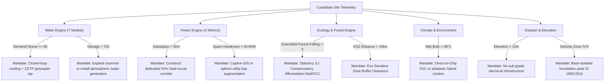

# SuperIndia.ai ⚡🇮🇳
> **Deterministic Geospatial Decision Intelligence Platform & Operating System for India's National AI Compute Infrastructure**

[](https://fastapi.tiangolo.com)
[](https://react.dev)
[](https://vitejs.dev)
[](https://tailwindcss.com)
[](https://leafletjs.com)
[](https://python.org)
[](LICENSE)

---

## 1. Executive Summary & National Imperative

India is undergoing an unprecedented expansion of digital, enterprise, and sovereign artificial intelligence capabilities under the national **IndiaAI Mission** (₹10,372 Crore outlay). However, deploying hyperscale GPU data center clusters requires navigating severe, interconnected physical, ecological, and regulatory bottlenecks:
- **Ecological Preservation & Forest Protection:** Forest Survey of India (FSI ISFR 2023) canopy density boundaries, tree felling restrictions, mandatory 3:1 Compensatory Afforestation directives, and Ministry of Environment, Forest and Climate Change (MoEFCC) Eco-Sensitive Zone (ESZ) buffers.
- **Hydrological Scarcity & Extraction Limits:** Central Ground Water Board (CGWB) groundwater extraction caps (SOE %), Copernicus GloFAS river basin discharge thresholds, municipal water rationing, and high Total Dissolved Solids (TDS) impacting cooling towers.
- **Extra High Voltage (EHV) Grid Headroom:** Central Electricity Authority (CEA) transmission planning criteria, substation N-1 contingency limits, transmission line Right-of-Way (RoW) lead times, and Green Energy Open Access Regulations.
- **Thermodynamic Cooling & Psychrometrics:** Elevated ambient wet-bulb temperatures demanding high Water Usage Effectiveness (WUE) or advanced Direct-to-Chip (D2C) closed-loop liquid and immersion cooling solutions.
- **Physical Resilience & Policy Variations:** Multi-hazard disaster exposure (BIS IS 1893 seismic zoning, 100-year flood zones, coastal high-tide surges) paired with divergent state-level capital subsidies and power tariff incentives.

**SuperIndia.ai** is an end-to-end, deterministic geospatial decision intelligence platform and infrastructure planning operating system designed for government bodies, hyperscalers, data center operators, and enterprise AI builders to scientifically site, design, allocate, and finance AI compute infrastructure across India.

### Core Architecture Axiom
> **"One model → one responsibility → domain aggregator → composite site assessment."**  
> **Zero black-box hallucinations.** All engineering evaluations, tier classifications, and mitigation mandates are derived mathematically and deterministically from physical telemetry, utility tariffs, and statutory engineering standards.

---

## 2. Core Platform Capabilities & Modules

SuperIndia.ai integrates eight core modules into a cohesive operational system:

```text
                                  ┌───────────────────────────────┐
                                  │         SuperIndia.ai         │
                                  │ National AI Infrastructure OS │
                                  └───────────────┬───────────────┘
                                                  │
         ┌─────────────────────────┬──────────────┴──────────────┬─────────────────────────┐
         ▼                         ▼                             ▼                         ▼
┌──────────────────┐      ┌──────────────────┐          ┌──────────────────┐      ┌──────────────────┐
│ 8-Domain Siting  │      │ Eco-Friendly DC  │          │ DC Engineering   │      │ GPU Marketplace  │
│ Geospatial Mesh  │      │ & Tree Protection│          │ Capacity Planner │      │ & Allocation     │
│ (CGWB / CEA/ FSI)│      │ (GloFAS / FSI)   │          │ (IT MW / PUE)    │      │ (IITs / C-DAC)   │
└──────────────────┘      └──────────────────┘          └──────────────────┘      └──────────────────┘
         │                         │                             │                         │
         └─────────────────────────┼─────────────────────────────┴─────────────────────────┘
                                   │
                    ┌──────────────┴──────────────┬─────────────────────────┐
                    ▼                             ▼                         ▼
         ┌──────────────────┐          ┌──────────────────┐      ┌──────────────────┐
         │ Sovereign Citizen│          │ State Policy &   │      │ National Demand  │
         │ Financing (AIIB) │          │ Incentives Engine│      │ Forecasting      │
         │ (Green Trusts)   │          │ (6 Major States) │      │ (2024-2030)      │
         └──────────────────┘          └──────────────────┘      └──────────────────┘
```

1. **8-Domain Geospatial Siting Mesh:** Computes deterministic viability across Power, Water, Ecology & Forest Protection, Climate, Connectivity, Disaster Resilience, Land, and Economics.
2. **Eco-Friendly DC & Forest Preservation Engine:** Ingests Copernicus GloFAS river discharge, ERA5 soil moisture, and FSI ISFR 2023 forest canopy data. Evaluates tree felling impacts, enforces statutory 3:1 compensatory afforestation, calculates closed-loop DLC water savings, and projects CEA carbon abatement.
3. **Data Center Engineering & Capacity Planner:** Models real-world hardware deployments (NVIDIA H100 SXM5, B200 NVL72, L40S, A100), rack densities, dynamic wet-bulb PUE, cooling water consumption (MLD), electrical substation sizing (MVA), and itemized CAPEX/OPEX in ₹ Crores.
4. **National GPU Marketplace & Allocation Engine:** Aggregates federated compute nodes across academic institutions (IIT Bombay, IIT Madras, IIT Delhi, IISc Bangalore), national laboratories (C-DAC AIRAWAT), and sovereign CSPs, allocating workloads to maximize utilization and minimize cost.
5. **National AI Demand Forecasting & Token Simulation:** Tracks India's 2024–2030 compute demand trajectories, project deficits, and translates daily active users (DAU) and token volumes into required GPUs, IT MW, and capital expenditure.
6. **Citizen Sovereign Infrastructure Financing:** Simulates public-private fractional participation through AI Infrastructure Bonds (AIIBs) and Green Compute Trusts, estimating APY yields, backed compute capacity, and clean energy offsets.
7. **Government Policy & State Matrix:** Catalogs and scores state-specific data center policies, capital subsidies (up to 25%), stamp duty exemptions, electricity duty waivers, and renewable power concessions.
8. **City Suggestion Engine & Greenfield Simulator:** Fast-entry directory of 100+ strategic Indian industrial nodes, SEZs, and smart cities (e.g., GIFT City, Dholera SIR, Sanand GIDC, YEIDA Jewar) with pre-verified survey coordinates, elevations, and real-time tree felling calculators.

---

## 3. Mathematical Formulations & Engineering Engines

### A. 8-Domain Composite Site Score Formulation

The platform synthesizes physical, hydrological, and environmental telemetry into a single composite index:

$$\text{Composite Score} = \sum_{k=1}^{8} \left( \text{Domain Score}_k \times \text{Weight}_k \right)$$

$$\begin{aligned}
\text{Composite Score} = \;&(\text{Power Score} \times 0.20) + (\text{Water Score} \times 0.18) + (\text{Ecology Score} \times 0.15) \\
&+\; (\text{Climate Score} \times 0.13) + (\text{Connectivity Score} \times 0.12) + (\text{Disaster Score} \times 0.08) \\
&+\; (\text{Land Score} \times 0.07) + (\text{Economics Score} \times 0.07)
\end{aligned}$$

| Domain # | Infrastructure Dimension | Weight | Statutory Authority & Authentic API Reference |
| :---: | :--- | :---: | :--- |
| **1** | **Electrical Transmission Grid** | **0.20** | **Central Electricity Authority (CEA)** Manual on Transmission Planning Criteria & MoP Green Energy Open Access 2022 |
| **2** | **Water Preservation Subsystem** | **0.18** | **Central Ground Water Board (CGWB)** & **BIS 10500** Quality Standards (7-Model Pipeline) |
| **3** | **Ecology, Forests & Tree Protection** | **0.15** | **Forest Survey of India (FSI ISFR 2023)**, **Copernicus GloFAS**, **ERA5 Hydrology** & **MoEFCC ESZ** |
| **4** | **Climate & Psychrometrics** | **0.13** | **NASA POWER Climatology API** & **CAMS ECMWF** (ASHRAE TC 9.9 Normals, Stull Wet-Bulb) |
| **5** | **Network & Connectivity** | **0.12** | **NIXI** Peering Mesh, Geodesic Fiber Latency (SMF-28 Glass Index) & International Subsea Cable Landing Stations |
| **6** | **Disaster & Seismic Resilience** | **0.08** | **Bureau of Indian Standards (BIS IS 1893:2016)** & **NASA SRTM 30m Global Elevation** |
| **7** | **Land & Civil Readiness** | **0.07** | State Industrial Development Corps (MIDC, GIDC, YEIDA, KIADB), Master Plan IT Zoning & Soil SBC |
| **8** | **Economics & State Policy** | **0.07** | State Electricity Regulatory Commissions (SERC) Industrial Tariffs & MeitY Capital Subsidies |

---

### B. Ecology, Forest Cover & Tree Preservation Engine (15% Domain Weight)

The platform deterministically evaluates environmental feasibility across five sub-metrics:

$$\text{Ecology Score} = \sum_{m=1}^{5} (\text{Sub-metric}_m \times \text{Weight}_m)$$

| Sub-Metric | Weight | Governing Criteria / Engineering Standard |
| :--- | :---: | :--- |
| **Tree Felling Impact & Existing Tree Protection** | **0.30** | Certified non-forest industrial land receives 100/100 (0 trees felled). Greenfield sites estimate tree cutting and trigger **mandatory 3:1 Compensatory Afforestation**. |
| **FSI Forest Canopy Preservation** | **0.25** | Forest Survey of India (ISFR 2023) canopy density mapping: Non-Forest ($<10\%$), Open Forest ($10\text{--}40\%$), Moderately Dense ($40\text{--}70\%$), Very Dense ($>70\%$). |
| **River Basin Discharge & Aquifer Shield** | **0.20** | **Copernicus GloFAS** river discharge ($m^3/s$) and ERA5 root-zone soil water retention to safeguard local hydro-basins. |
| **Clean Energy Carbon Abatement** | **0.15** | Offsite Solar/Wind PPA and rooftop generation offsetting grid carbon against the CEA grid emission factor ($0.716\text{ kg CO}_2/\text{kWh}$). |
| **Eco-Sensitive Zone (ESZ) Buffer** | **0.10** | Enforces statutory $10\text{ km}$ buffer distances from National Parks and Wildlife Sanctuaries as per Supreme Court & MoEFCC notifications. |

#### Mathematical Tree Felling & Afforestation Model:
- **Notified Non-Forest Industrial Parcels (e.g., MIDC, GIDC, SEZs):**  
  $$\text{Estimated Trees to Cut} = 0 \quad (\text{Preservation Score} = 100/100)$$
- **Greenfield Sites:**  
  $$\text{Estimated Trees to Cut} = \text{round}\left( \text{Campus Acres} \times \text{Canopy Cover \%} \times 4.2 \right)$$
  $$\text{Compensatory Saplings Required (3:1)} = \text{Estimated Trees to Cut} \times 3$$

---

### C. 7-Model Water Engine (CGWB & BIS Standards — 18% Domain Weight)

$$\text{Water Score} = \sum_{i=1}^{7} (\text{Sub-score}_i \times \text{Weight}_i)$$

| Sub-Model | Weight | Governing Criteria / Engineering Standard |
| :--- | :---: | :--- |
| **Water Availability** | **0.15** | CGWA Stage of Groundwater Extraction ($\le 70\%$ Safe, $70\text{--}90\%$ Semi-critical, $90\text{--}100\%$ Critical, $>100\%$ Over-exploited) |
| **Water Quality** | **0.15** | BIS 10500 Total Dissolved Solids (TDS in mg/L) and silica/hardness cooling tower scaling indices |
| **Demand Stress** | **0.15** | Competing industrial extraction and aquifer draft. **Sub-score $< 60$ automatically triggers a Stress Flag.** |
| **Reuse & Effluent Proximity** | **0.15** | Distance to nearest STP / CETP tertiary treatment plant (km) and recycled MLD availability |
| **Supply vs Demand Balance** | **0.20** | Volumetric ratio of assured municipal/industrial allocation (MLD) to projected AI cooling demand |
| **Storage Headroom (72h Buffer)** | **0.10** | On-site emergency chilled/raw water storage buffer measured against 72-hour mission-critical mandate |
| **Climate Resilience** | **0.10** | Multi-factor drought vulnerability index and local catchment replenishment rates |

---

### D. 4-Metric Electrical Transmission Grid Pipeline (CEA Criteria — 20% Domain Weight)

$$\text{Power Score} = \sum_{j=1}^{4} (\text{Metric Score}_j \times \text{Weight}_j)$$

| Metric | Weight | Engineering Criteria (CEA Transmission Planning Guidelines) |
| :--- | :---: | :--- |
| **Substation Proximity** | **0.30** | Distance to nearest Extra High Voltage (EHV) substation ($\le 1.5\text{km}$ prime, $1.5\text{--}5\text{km}$ viable, $>5\text{km}$ high Right-of-Way risk) |
| **Voltage Class** | **0.30** | Transmission interconnect voltage: $400\text{kV}$ (100 pts), $220\text{kV}$ (85 pts), $132\text{kV}$ (70 pts), $66/33\text{kV}$ (50 pts), $11\text{kV}$ (25 pts) |
| **Substation Spare MVA Margin** | **0.20** | Available transformer headroom under N-1 contingency relative to proposed IT demand (MW) |
| **Renewable Open Access Corridors** | **0.20** | ISTS Green Energy Corridor connectivity, solar/wind PPA feasibility, and cross-subsidy surcharge waivers |

---

### E. Classification Tiers & Decision Boundaries

| Tier Badge | Composite Score | Classification | Color Code | Strategic Recommendation |
| :--- | :---: | :--- | :---: | :--- |
| **VIABLE** | $\ge 75.0$ | **VIABLE / RECOMMENDED** | `#10B981` (Emerald) | Fast-track environmental clearances, land acquisition, and EPC design |
| **CONDITIONAL** | $50.0 - 74.9$ | **CONDITIONAL / HIGH RISK** | `#F59E0B` (Amber) | Feasible only with mandatory capital mitigation investments |
| **UNVIABLE** | $< 50.0$ | **UNVIABLE / REJECT** | `#EF4444` (Red) | High-risk greenfield site; reject for hyperscale mission-critical compute |

---

### F. Automated Diagnostic & Engineering Mitigation Engine

The platform continuously executes rule-based diagnostic assertions across all 8 domains and generates compulsory engineering mandates:



- **Tree Felling on Greenfield Sites:**  
  *Risk Flag:* `"Compensatory Afforestation Triggered"`  
  *Mandate:* `"Statutory 3:1 Compensatory Afforestation required under MoEFCC guidelines. Certified replacement plantation plan required."`
- **Eco-Sensitive Zone Proximity $< 10\text{km}$:**  
  *Risk Flag:* `"Within MoEFCC Eco-Sensitive Zone (ESZ)"`  
  *Mandate:* `"Candidate perimeter within 10km of Protected Wildlife Sanctuary/National Park. Buffer clearance from MoEFCC required."`
- **Demand Stress $\le 50$:**  
  *Risk Flag:* `"Competitive industrial extraction stress"`  
  *Mandate:* `"Deploy on-site closed-loop cooling towers. Tap CETP tertiary treated greywater to eliminate groundwater draft."`
- **Site Ground Elevation $< 10\text{m}$:**  
  *Risk Flag:* `"100-year flood zone & CRZ restrictions"`  
  *Mandate:* `"Unviable for sub-grade electrical infrastructure. Elevate critical transformers above high flood level."`
- **Substation Proximity $> 5\text{km}$:**  
  *Risk Flag:* `"Transmission Right-of-Way (RoW) acquisition latency"`  
  *Mandate:* `"Construct dedicated EHV transmission line corridor with redundant dual-circuit bays."`
- **Substation Spare Headroom $< 40\text{ MVA}$:**  
  *Risk Flag:* `"Constrained N-1 contingency grid margin"`  
  *Mandate:* `"Require captive Gas Insulated Substation (GIS) or upfront utility transformer augmentation."`
- **Design Wet-Bulb Temperature $> 28^\circ\text{C}$:**  
  *Risk Flag:* `"Elevated Wet-Bulb Cooling Limit Exceeded"`  
  *Mandate:* `"Mandate Direct-to-Chip (D2C) liquid cooling or adiabatic hybrid coolers to prevent thermal derating during peak summer."`

---

### G. Authentic Real-Data Telemetry Architecture (Zero Guessing Policy)

To eliminate simulated guesses and ground every evaluation in genuine physical telemetry, SuperIndia.ai integrates directly with official public and statutory Indian Government APIs:

| Domain | Integrated Authentic API & Statutory Source | Live Telemetry & Parameters Ingested |
| :--- | :--- | :--- |
| **Forest & Biodiversity** | **Forest Survey of India (FSI ISFR 2023)** & **MoEFCC** | Canopy cover %, forest density classification, tree preservation index, Eco-Sensitive Zone (ESZ) boundaries |
| **River & Hydrology** | **Copernicus GloFAS & Open-Meteo ERA5** | River basin discharge ($m^3/s$), volumetric root-zone soil water, and catchment replenishment |
| **Climate & Psychrometrics** | **NASA POWER Climatology API** (`https://power.larc.nasa.gov`) | 30-year dry bulb temperature (`T2M`), relative humidity (`RH2M`), cooling degree days (`CDD18_3`), Stull wet-bulb formula |
| **Terrain & Elevation** | **NASA SRTM 30m Global Elevation Model** | Ground truth terrain elevation in meters above sea level (ASL) for flood margin & psychrometric density corrections |
| **Air Quality** | **Open-Meteo / CAMS ECMWF** | Real-time PM2.5 and PM10 atmospheric particulates mapped to CPCB National Ambient Air Quality Standards |
| **Groundwater Extraction** | **Central Ground Water Board (CGWB) & Jal Shakti** | Dynamic Ground Water Resources Assessment 2023: Stage of Groundwater Extraction (SOE %) and regional TDS (mg/L) |
| **Electrical Transmission Grid** | **Central Electricity Authority (CEA) & State TRANSCOs** | Transmission Planning Criteria, EHV 220kV/400kV substation proximity, N-1 transformer margin |
| **Network & Subsea Transit** | **National Internet Exchange of India (NIXI) & TRAI** | Subsea Cable Landing Station (CLS) geodesic latency (SMF-28 glass index) and NIXI Peering mesh |
| **Disaster Resilience** | **Bureau of Indian Standards (BIS IS 1893:2016) & USGS** | Statutory Indian seismic zonation (Zones II–V) and USGS earthquake hazard catalog within 250km radius |

---

## 4. Strategic Benchmark Demonstration Hubs

SuperIndia.ai comes pre-seeded with 8 verified national AI and data center hubs evaluated under the 8-domain model:

| Site Name | State | Composite Score | Tier | Water | Power | Eco | Key Strategic Highlights |
| :--- | :--- | :---: | :---: | :---: | :---: | :---: | :--- |
| **Hyderabad - Fab City / Shamshabad** | Telangana | **91.8** | **VIABLE** | 88.0 | 94.0 | 92.5 | 400kV dedicated GIS, Telangana AI City policy incentives, zero forest felling |
| **Dholera SIR (Special Investment Region)** | Gujarat | **86.4** | **VIABLE** | 82.5 | 92.0 | 94.0 | 5GW Ultra Mega Solar Park, ₹18/kL Narmada water, 0 trees cut (non-forest industrial) |
| **Greater Noida - Knowledge Park V / Sec 132** | Uttar Pradesh | **83.0** | **VIABLE** | 76.5 | 87.0 | 85.0 | Dual 220kV independent substations, 10-year electricity duty waiver, Yamuna basin buffer |
| **Mahape MIDC (TTC Industrial Area)** | Maharashtra | **80.8** | **VIABLE** | 74.0 | 86.4 | 88.0 | 220kV EHV grid (1.5 km), subsea cable landing connectivity, certified industrial park |
| **Chennai - Siruseri SIPCOT (OMR)** | Tamil Nadu | **75.6** | **VIABLE** | 71.0 | 80.5 | 82.0 | Bay of Bengal subsea cable landing stations, Tamil Nadu Data Center Policy 2021 |
| **Bengaluru - KIADB Aerospace Park** | Karnataka | **74.0** | **CONDITIONAL** | 63.5 | 81.0 | 79.5 | High tech talent ecosystem, groundwater extraction limits require recycled water |
| **Taloja MIDC (Industrial Corridor)** | Maharashtra | **73.2** | **CONDITIONAL** | 61.6 | 82.7 | 81.0 | 1050 mg/L TDS brackish chemical load; high industrial competition for water |
| **Coastal South Mumbai (Port Trust)** | Maharashtra | **60.8** | **CONDITIONAL** | 62.4 | 59.6 | 72.0 | 4.2m elevation triggers 100-year flood zone and CRZ restriction mandates |

---

## 5. Monorepo Project Architecture

```text
SuperIndia.ai/
├── backend/
│   ├── app/
│   │   ├── api/
│   │   │   ├── endpoints.py                 # REST route controllers (8 core domains + /api/eco/assess)
│   │   │   └── __init__.py
│   │   ├── core/
│   │   │   ├── config.py                    # Application configuration & CORS setup
│   │   │   └── __init__.py
│   │   ├── data/
│   │   │   └── benchmark_sites.json         # Ground-truth telemetry for 8 national hubs
│   │   ├── models/
│   │   │   ├── schemas.py                   # Pydantic v2 domain schemas (EcoInput, SiteAssessmentResponse)
│   │   │   └── __init__.py
│   │   ├── services/
│   │   │   ├── eco_telemetry_service.py     # GloFAS hydrology, ERA5 soil water & FSI tree felling engine
│   │   │   ├── live_telemetry_service.py    # Authentic live ingestion from NASA, CAMS & Indian Gov APIs
│   │   │   ├── aggregator.py                # 8-domain composite scoring & mitigation engine (100% wt)
│   │   │   ├── water_engine.py              # 7-model CGWA & BIS water assessment pipeline
│   │   │   ├── power_engine.py              # 4-metric CEA electrical transmission pipeline
│   │   │   ├── climate_engine.py            # Wet-bulb psychrometrics & thermal modeling
│   │   │   ├── connectivity_engine.py       # Dark fiber, NIXI, and subsea cable landing engine
│   │   │   ├── disaster_engine.py           # BIS IS 1893 seismic & flood inundation analysis
│   │   │   ├── land_engine.py               # Contiguous parcel sizing & industrial zoning
│   │   │   ├── economics_engine.py          # State policy incentives & power tariff modeling
│   │   │   ├── dc_planner.py                # Data center capacity, PUE, rack & CAPEX planner
│   │   │   ├── marketplace_engine.py        # Federated cross-institution GPU compute broker
│   │   │   ├── demand_forecast_engine.py    # 2024-2030 national compute projection & token simulator
│   │   │   ├── citizen_financing_engine.py  # Fractional AI Infrastructure Bonds & Green Trusts
│   │   │   ├── policy_engine.py             # State-wise data center policy knowledgebase
│   │   │   └── __init__.py
│   │   └── main.py                          # FastAPI ASGI application entrypoint
│   ├── requirements.txt                     # Backend dependencies (FastAPI, Uvicorn, Pydantic)
│   └── run.py                               # Standalone server launcher with host binding
├── frontend/
│   ├── src/
│   │   ├── components/
│   │   │   ├── MapView.jsx                  # Interactive Leaflet dark-mode geospatial mesh
│   │   │   ├── ScoreCard.jsx                # Symmetrical 8-axis spider radar chart & 2x4 dimension cards
│   │   │   ├── ExplainabilityPanel.jsx      # Granular sub-metric breakdowns (8 domains, 36 sub-metrics)
│   │   │   ├── EcoPlannerTab.jsx            # Eco-Friendly DC, closed-loop DLC hydraulics & tree audit tab
│   │   │   ├── MitigationCard.jsx           # Automated risk flags & engineering mandates
│   │   │   ├── SiteComparison.jsx           # Multi-site audit matrix with Eco/Forest column & tree status
│   │   │   ├── CustomSiteModal.jsx          # Greenfield simulation modal with city search & tree calculator
│   │   │   ├── DCPlannerTab.jsx             # Hardware selection, PUE & CAPEX calculator UI
│   │   │   ├── MarketplaceTab.jsx           # Federated GPU node explorer & allocation optimizer
│   │   │   ├── DemandForecastTab.jsx        # 2024-2030 compute deficit charts & token simulator
│   │   │   ├── CitizenFinancingTab.jsx      # Sovereign bond participation & yield simulator
│   │   │   └── PolicyIntelligenceTab.jsx    # State policy comparisons and IndiaAI mission pillars
│   │   ├── data/
│   │   │   └── indianPlaces.js              # 100+ verified Indian industrial nodes & SEZs
│   │   ├── services/
│   │   │   └── api.js                       # Axios API client connecting to FastAPI backend
│   │   ├── App.jsx                          # Main command center layout & tab coordinator
│   │   ├── index.css                        # Design system tokens, typography & Leaflet styles
│   │   └── main.jsx                         # React DOM application mount
│   ├── index.html                           # HTML entry with responsive viewport and Google Fonts
│   ├── package.json                         # Frontend dependencies (React, Lucide, Leaflet, Tailwind)
│   ├── tailwind.config.js                   # Design system palette, surface colors & borders
│   ├── postcss.config.js
│   └── vite.config.js                       # Vite bundler configuration with unified backend proxy
├── tests/
│   ├── test_eco_engine.py                   # Unit tests for tree felling, GloFAS discharge & water savings
│   ├── test_live_telemetry_integration.py   # Integration verification for authentic NASA & FSI telemetry
│   ├── test_e2e_verification.py             # Comprehensive API end-to-end integration test suite
│   └── test_tunnel_verification.py          # Public tunnel and reverse proxy health verification
├── docs/                                    # Architectural blueprints & research whitepapers
├── start.bat                                # Unified one-click launch script (Windows)
├── start.sh                                 # Unified one-click launch script (Linux / macOS)
├── tunnel.bat                               # Public HTTPS tunnel launcher (Windows)
├── tunnel.sh                                # Public HTTPS tunnel launcher (Linux / macOS)
└── run_tunnel.py                            # Python tunnel runner (Cloudflare Tunnel / localtunnel)
```

---

## 6. Comprehensive REST API Reference

The FastAPI backend exposes interactive OpenAPI documentation at `http://127.0.0.1:8000/docs`.

### 1. System & Health
| Method | Endpoint | Description |
| :--- | :--- | :--- |
| `GET` | `/health` / `/api/health` | Health check verifying status of all platform engines |

### 2. Siting Intelligence (8 Statutory Domains)
| Method | Endpoint | Description |
| :--- | :--- | :--- |
| `GET` | `/api/sites` | Retrieve calculated 8-domain assessments for all national benchmark hubs |
| `GET` | `/api/sites/{site_id}` | Retrieve comprehensive 8-domain telemetry, eco metrics, and mandates for a single hub |
| `POST` | `/api/assess` | Execute the deterministic 8-domain assessment on an arbitrary custom greenfield payload |
| `POST` | `/api/telemetry/fetch-real-data` | Ingest real-time physical telemetry from NASA POWER, NASA SRTM, CAMS, USGS, CGWB & FSI for any Indian coordinate |
| `POST` | `/api/assess/live` | One-click assessment evaluating an arbitrary coordinate directly with verified live NASA/Gov telemetry |
| `POST` | `/api/compare` | Multi-site ranking and comparative analysis matrix across all 8 domains |

### 3. Ecology & Environmental Engineering Engine
| Method | Endpoint | Description |
| :--- | :--- | :--- |
| `POST` | `/api/eco/assess` | Ingests IT load, cooling mode, rooftop/offsite solar MW, and coordinates. Computes Copernicus GloFAS river discharge, ERA5 soil moisture, FSI canopy density, estimated tree felling, closed-loop DLC water preservation (MLD), and CEA carbon abatement. |

### 4. Data Center Engineering Planner
| Method | Endpoint | Description |
| :--- | :--- | :--- |
| `GET` | `/api/dc/hardware` | Catalog of verified GPU hardware specs (H100, B200 NVL72, L40S) and cooling architectures |
| `POST` | `/api/dc/plan` | Computes rack counts, IT MW, facility power, wet-bulb PUE, water MLD, substation MVA, and CAPEX/OPEX in ₹ Cr |

### 5. GPU Compute Marketplace & Allocation
| Method | Endpoint | Description |
| :--- | :--- | :--- |
| `GET` | `/api/marketplace/nodes` | Live inventory of federated academic (IITs, IISc) and commercial GPU nodes |
| `POST` | `/api/marketplace/allocate` | Multi-objective workload allocation optimization balancing latency, price, and green energy |

### 6. National Demand Forecasting
| Method | Endpoint | Description |
| :--- | :--- | :--- |
| `GET` | `/api/demand/forecast` | National compute milestones (2024–2030) with training vs inference split and GPU deficits |
| `POST` | `/api/demand/simulate` | Translates user DAU and daily token throughput targets into required GPUs, MW, and CAPEX |

### 7. Citizen Sovereign Financing
| Method | Endpoint | Description |
| :--- | :--- | :--- |
| `GET` | `/api/citizen/projects` | Flagship sovereign green AI projects open for fractional bond participation |
| `POST` | `/api/citizen/simulate` | Simulates fractional investment returns, backed GPU units, and clean power offsets |

### 8. Policy Intelligence
| Method | Endpoint | Description |
| :--- | :--- | :--- |
| `GET` | `/api/policy/states` | Comparative database of state data center policies and incentive matrices |
| `GET` | `/api/policy/india-ai` | Pillars, compute allocations, and guidelines of the national IndiaAI Mission |

---

## 7. Quick Start & Execution Guide

### Prerequisites
- **Python:** 3.10 or higher
- **Node.js:** 18.0.0 or higher with npm

---

### Method A: One-Click Unified Launch

The repository includes startup scripts that launch both the FastAPI backend and Vite frontend concurrently:

**On Windows:**
```cmd
start.bat
```

**On Linux / macOS:**
```bash
chmod +x start.sh
./start.sh
```

- **Frontend Command Center:** `http://localhost:5173`
- **Backend REST API:** `http://127.0.0.1:8000`
- **Interactive Swagger Documentation:** `http://127.0.0.1:8000/docs`

---

### Method B: Manual Component Startup

#### 1. Start the Backend API
```bash
cd backend
pip install -r requirements.txt
python run.py
```
*The backend server binds to `0.0.0.0:8000`.*

#### 2. Start the Frontend Command Center
```bash
cd frontend
npm install
npm run dev
```
*The frontend development server launches at `http://localhost:5173`.*

---

### Method C: Instant Public HTTPS Tunnel (For Remote Access & Demonstrations)

To expose the application publicly over a secure HTTPS URL for stakeholders, remote partners, or mobile device testing without CORS or localhost issues:

**On Windows:**
```cmd
tunnel.bat
```

**On Linux / macOS:**
```bash
chmod +x tunnel.sh
./tunnel.sh
```

*This verifies local port availability, starts the unified Vite reverse proxy, spawns a persistent Cloudflare or localtunnel tunnel, and outputs the public HTTPS endpoint.*

---

## 8. Verification & Test Suite

SuperIndia.ai comes with an automated verification suite covering the 8-domain scoring model, live environmental telemetry, and full API integration:

```bash
# 1. Run Environmental & Tree Engine Tests
pytest tests/test_eco_engine.py

# 2. Run Live Telemetry Integration Tests
pytest tests/test_live_telemetry_integration.py

# 3. Run End-to-End API Verification
python tests/test_e2e_verification.py
```

The test runners validate:
1. Retrieval and schema conformity of all 8 national benchmark hubs under the 8-domain model.
2. Execution of the tree felling estimator: 0 trees cut for industrial zones; dynamic compensatory afforestation (3:1) for greenfields.
3. Live ingestion of Copernicus GloFAS river discharge and FSI canopy coverage.
4. Proper firing of automated regulatory risk flags and engineering mitigation mandates.
5. Symmetrical 8-axis polygon coordinates generation for the radar spider chart.

---

## 9. Design System & Software Architecture

The SuperIndia.ai user interface is engineered according to an enterprise-grade software design system:
- **Clean Neutral Surface Palette:** Built on a layered light surface palette (`#fcfcfd`, `#f3f4f6`) with ruled borders (`#dde0e6`) for high readability in command-center environments.
- **Symmetrical 8-Axis Radar Spider Chart:** Perfectly balanced 8-spoke radial visualization ($45^\circ$ axis spacing) rendering the multi-domain balance across Power, Water, Ecology, Climate, Fiber, Disaster, Land, and Policy.
- **Geospatial Dark-Mode Cartography:** Leaflet map with inverted high-contrast dark tiles, status-coded pulsing SVG markers (Emerald for Viable, Amber for Conditional, Red for Unviable), and interactive coordinate click-handlers.
- **Granular Explainability:** Interactive telemetry drawers visualizing all 36 sub-metrics with linear progress bars, exact units (MLD, TDS mg/L, kV, MVA, $m^3/s$, saplings), and statutory threshold markings.
- **Deterministic Reactive Modals:** Greenfield site creation modal backed by `indianPlaces.js` city database for instantaneous population of geographic coordinates, elevations, FSI canopy coverage, and tree preservation status.

---

## 10. Roadmap & Alignment with the IndiaAI Mission

- [x] **Phase 1: Deterministic Siting Foundation** — 8-domain mathematical scoring for power, water, ecology, climate, connectivity, disaster, land, and economics.
- [x] **Phase 2: Tree Protection & Ecological Ingestion** — FSI ISFR 2023 forest canopy density, tree cutting estimators, 3:1 compensatory afforestation, and GloFAS river discharge.
- [x] **Phase 3: Data Center Engineering Sizing** — Dynamic PUE, closed-loop DLC liquid cooling hydraulics, rack density, and itemized CAPEX/OPEX models.
- [x] **Phase 4: National GPU Federation** — Cross-institution marketplace integrating academic (IITs, IISc) and sovereign compute clusters.
- [x] **Phase 5: Sovereign Financing & Policy Integration** — AI Infrastructure Bond (AIIB) fractional simulation and multi-state policy intelligence.
- [ ] **Phase 6: Real-Time Grid & Satellite Ingestion** — Direct API integration with POSOCO / Grid-Controller of India telemetry and ISRO Bhuvan hydrological imagery.
- [ ] **Phase 7: Multi-Tenant Enterprise Role-Based Access** — Enterprise workspace management for state IT departments, power utilities, and hyperscale EPC contractors.

---

## 11. Authors & License

- **Lead Developer:** Drona Jadhav ([@Drona-jadhav7](https://github.com/Drona-jadhav7))  
- **License:** Apache License 2.0 — see [LICENSE](LICENSE) for details.
